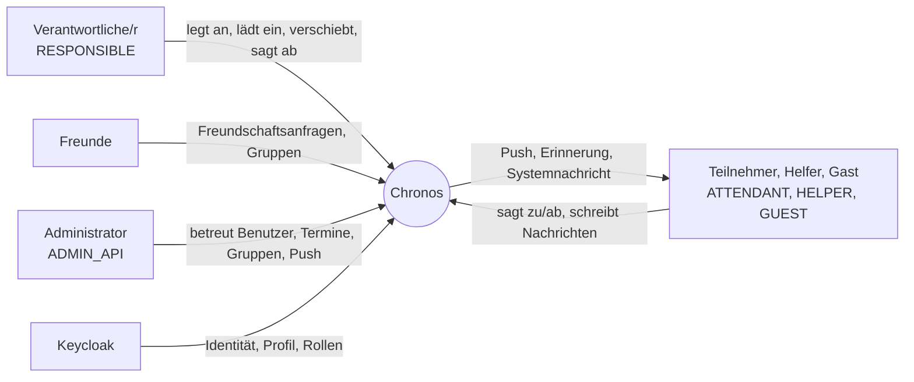

# Fachlicher Kontext

| Partner | Eingaben an Chronos | Ausgaben von Chronos |
|---|---|---|
| Verantwortliche/r | Termin anlegen, ändern, verschieben, absagen, löschen; Personen und Gruppen einladen oder entfernen; Rollen ändern | Push bei Zu-/Absagen und zu wenigen Zusagen |
| Teilnehmer, Helfer, Gast | Zu-/Absage (`APPROVED`, `REJECTED`), Nachrichten, Benachrichtigungseinstellungen, Push-Abo | Einladungen, Änderungen, Erinnerungen, Systemnachrichten im Termin |
| Freunde | Freundschaftsanfrage senden, annehmen, ablehnen, zurückziehen, beenden; Gruppen führen | Push zu Anfragen und Gruppenänderungen |
| Administrator | Admin-Endpunkte unter `/api/v2/admin/*` (Rolle `ADMIN_API` in Keycloak) | Statistik, Push-Log |
| Keycloak ([KT-003](KT-003-keycloak.md)) | Anmeldung und Registrierung, Subject-ID und Profildaten (Name, E-Mail, Bild), Rollen | Anfragen zur Benutzersuche, Profil- und Kontopflege |
| Push-Dienste ([KT-004](KT-004-push-dienste.md)) | Zustellstatus (Abo gültig oder abgelaufen) | verschlüsselte Benachrichtigungstexte |
| Betrieb und Monitoring ([KT-006](KT-006-s3-backup.md), [KT-007](KT-007-prometheus-grafana.md)) | – | Metriken, Health, Datenbanksicherung |

Die Rolle eines Teilnehmers gilt je Termin (`UserRole`: `NONE`, `GUEST`, `ATTENDANT`, `HELPER`, `RESPONSIBLE`); Einladen setzt eine Freundschaft bzw. Gruppenmitgliedschaft voraus ([KZ-002](../08-konzepte/KZ-002-autorisierung.md)).
