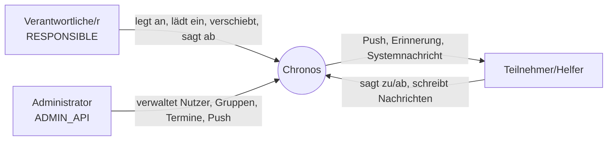

# Fachlicher Kontext

Chronos plant Termine für Jugendorganisationen. Fachliche Akteure und Austausch:

| Akteur | Schnittstelle zu Chronos |
|---|---|
| Verantwortliche/r | Termin anlegen/ändern/verschieben/absagen, Teilnehmer und Gruppen einladen, Rollen ändern |
| Teilnehmer / Helfer | Einladung beantworten (`APPROVED`, `REJECTED`, `PENDING`), Termin-Chat, Push-Einstellungen |
| Administrator | Admin-API `/api/v2/admin/*`, Admin-Seiten im Frontend |
| Freunde | Freundschaftsanfragen, Gruppen (Voraussetzung zum Einladen) |
