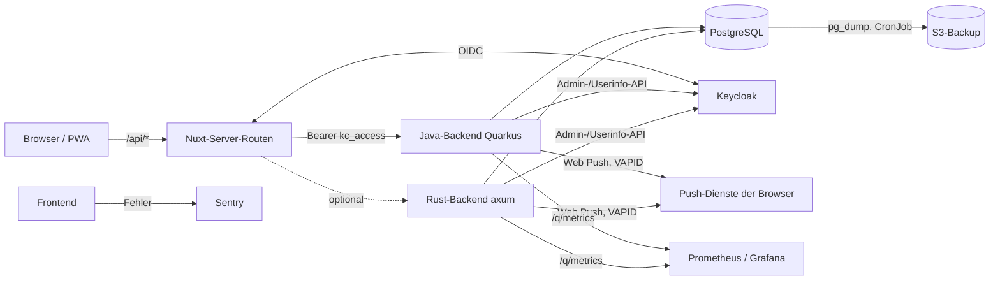

# Technischer Kontext

- Der Browser spricht nie direkt mit dem Backend (RB-004); alle Aufrufe laufen über `/api/v2/[...path].ts`.
- Java- und Rust-Backend sind API-kompatibel (QA-001); der Betrieb des Rust-Backends ist optional (`kb/adr/ADR-2026-10-20-018-rust-deploy-opt-in.md`).
- Zugriffsschutz über OIDC (RB-002).
