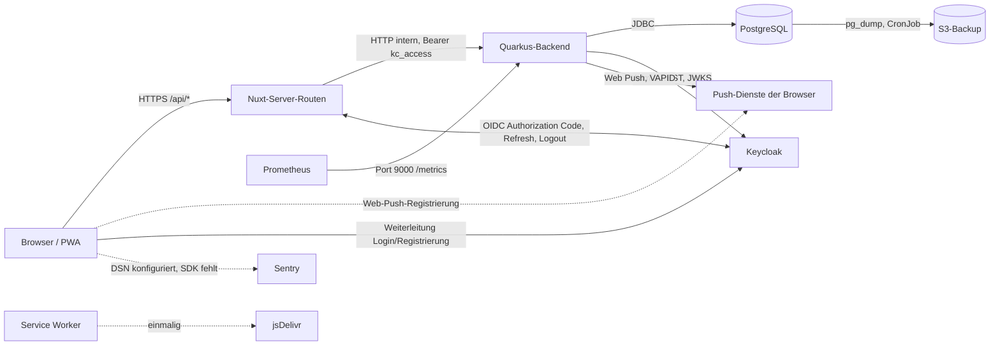

# Technischer Kontext

| Kanal | Protokoll | Anmerkung |
|---|---|---|
| Browser → Nuxt-Server | HTTPS, Cookies `kc_access`, `kc_refresh` (httpOnly), `kc_expires` | Einziger Eingang; der Browser kennt die Backend-URL nicht (AE-013) |
| Nuxt-Server → Backend | HTTP im Cluster (`NUXT_QUARKUS_URL`, Service `chronos-backend`, Port 80 → 8080) | Pfad `/api/v2/<path>` mit `Authorization: Bearer` aus `kc_access` |
| Nuxt-Server → Keycloak | HTTPS, OIDC-Endpunkte `…/protocol/openid-connect/{auth,token,logout,registrations}` | [KT-003](KT-003-keycloak.md) |
| Backend → Keycloak | HTTPS, Admin REST Client und Token-Validierung | gleiche Konfiguration `AUTH_SERVER_*` |
| Backend → PostgreSQL | JDBC (Agroal-Pool) | [KT-005](KT-005-postgresql.md) |
| Backend → Push-Dienste | HTTPS Web Push mit VAPID | [KT-004](KT-004-push-dienste.md) |
| Prometheus → Backend | HTTP Port 9000 (Management-Schnittstelle) | [KT-007](KT-007-prometheus-grafana.md) |

| Fachliche Beziehung ([KT-001](KT-001-fachlicher-kontext.md)) | Technischer Kanal |
|---|---|
| Alle Nutzeraktionen (Termine, Zu-/Absage, Nachrichten, Freunde, Gruppen, Einstellungen, Admin) | Browser → Nuxt-Server `/api/v2/*` → Backend `/api/v2/*` (JSON über REST) |
| Anmeldung, Registrierung, Abmeldung | Browser → Nuxt-Server `/api/auth/*` ↔ Keycloak (OIDC); Cookies `kc_*` |
| Benachrichtigungen, Erinnerungen | Backend → Push-Dienste (Web Push, VAPID); Abo-Verwaltung über `/api/v2/push/*` |
| Profil-, Passkey- und Passwortpflege | Backend erzeugt Keycloak-Aktions-URLs, Browser wird weitergeleitet |
| Datensicherung, Metriken | CronJob → S3; Prometheus → Port 9000 |

Das Backend ist nicht über den Ingress erreichbar; der Ingress leitet nur auf das Frontend (`ingress.yaml`). Zugriffsschutz über OIDC (RB-002).
