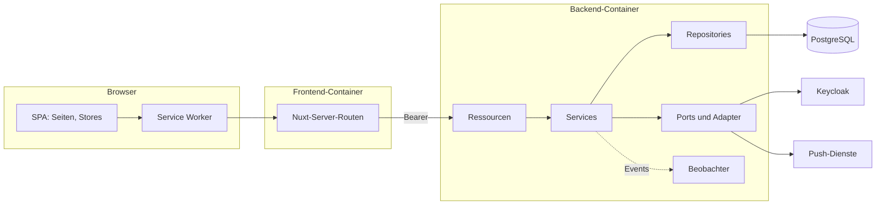

# Whitebox Gesamtsystem (Ebene 1)

| Baustein | Verantwortung | Schnittstelle nach außen |
|---|---|---|
| [Frontend](BB-001-frontend.md) | Oberfläche, Anmeldestatus, Zustand, Push-Anzeige | `/api/*` am Nuxt-Server |
| [Java-Backend](BB-005-java-backend.md) | Fachlogik, Autorisierung, Persistenz, Benachrichtigung, Zeitsteuerung | REST `/api/v2/**` (JSON), Management-Port 9000 |
| [Admin-Bereich](BB-015-admin-bereich.md) | Betreuung durch Administratoren (Teil von Frontend und Backend) | `/api/v2/admin/**` |
| [Datenbank](BB-018-datenbank.md) | Schema und Migrationen | JDBC |

**Begründung der Zerlegung:** Der Browser kennt nur den Nuxt-Server, der als Proxy die Tokens führt ([LS-002](../04-loesungsstrategie/LS-002-server-routen-als-proxy.md)); das Backend bündelt Fachlogik und Zeitsteuerung, ist zustandslos bis auf die Datenbank und deshalb mehrfach instanziierbar ([LS-012](../04-loesungsstrategie/LS-012-leader-election-fuer-zeitgesteuerte-aufgaben.md)); Identitätsdaten bleiben in Keycloak ([LS-003](../04-loesungsstrategie/LS-003-oidc-mit-keycloak.md)).

Die Auslieferung als Kubernetes-Ressourcen beschreibt [Kapitel 7](../07-verteilung/README.md), nicht die Bausteinsicht.
