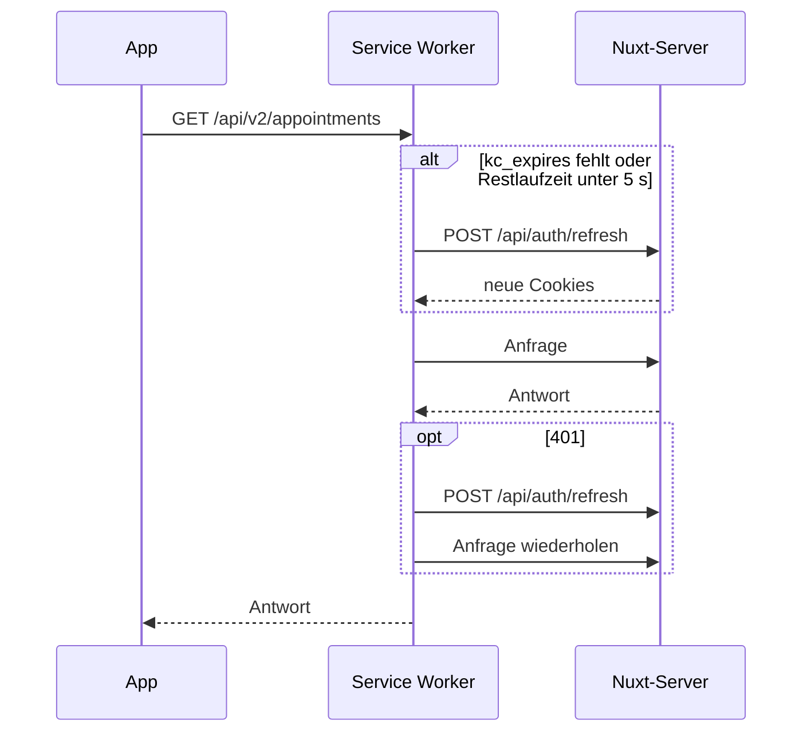

# Token-Refresh und Sitzungsende

Unabhängig von Anfragen plant der Service Worker beim Aktivieren und bei jeder Änderung von `kc_expires` einen Refresh 30 s vor Ablauf. Schlägt der Refresh fehl, antwortet der Server mit 401 (kein oder ungültiges Refresh-Token, Cookies werden gelöscht) oder 502 (ungültige Keycloak-Antwort). Wird `kc_expires` gelöscht, sendet der Service Worker `SESSION_EXPIRED` an alle Fenster, und `auth.client.ts` navigiert auf `/`. Schlägt das Wiederholen nach einer 401 fehl, gibt der Service Worker die ursprüngliche 401 zurück.
