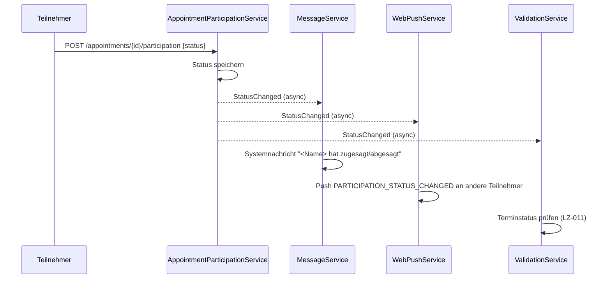

# Zu- und Absage

`POST /api/v2/appointments/{id}/participation` mit `status` `APPROVED` oder `REJECTED`. `changeParticipationStatus` verlangt irgendeine Rolle außer `NONE`, lehnt `PENDING` und den bereits gesetzten Status mit 400 ab und verlangt eine bestehende Teilnahme. Der Service löst `AppointmentParticipationStatusChangedEvent` synchron und zusätzlich asynchron aus; die drei Beobachter oben laufen asynchron in eigener Transaktion. Die Systemnachricht entsteht im Namen des Handelnden. Das Frontend bietet Zu-/Absage auch als Aktion der Push-Benachrichtigung an; beide Clients nutzen Pfade, die im Backend-Code anders lauten ([BB-006](../05-bausteine/BB-006-java-schichten.md)).
