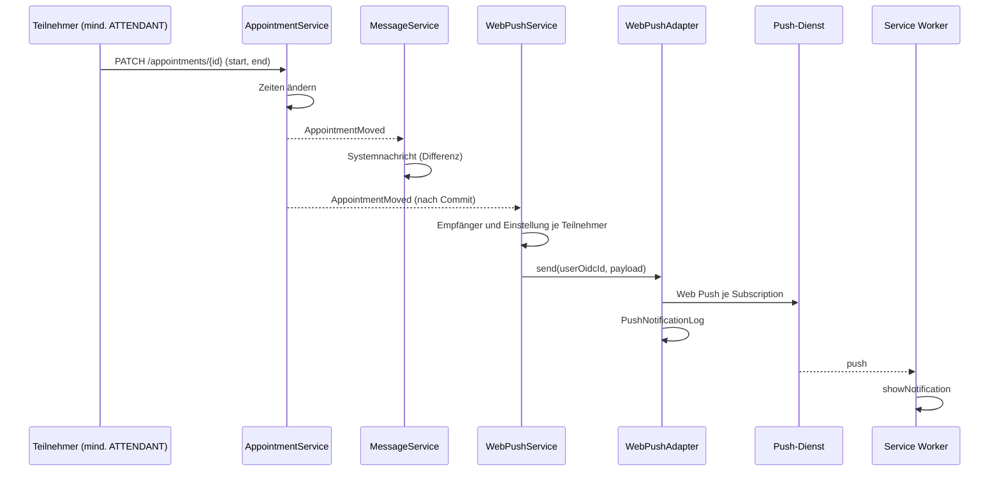

# Verschiebung eines Termins mit Push

1. `AppointmentService.updateAppointment` verlangt mindestens die Rolle `ATTENDANT` (`requireUpdateAppointment`) und löst `AppointmentMovedEvent` nur aus, wenn sich Start oder Ende ändern; zusätzlich folgt immer `AppointmentEditedEvent` ([LZ-011](LZ-011-mindestteilnehmerzahl.md)).
2. `MessageService` erzeugt sofort die Systemnachricht: der Start hat Vorrang („… hat diesen Termin um 1 Stunde 30 Minuten nach hinten verschoben“ bzw. „vorverlegt“), sonst „… hat das Ende dieses Termins um … verschoben“; bei weniger als einer Minute Änderung entsteht keine Nachricht.
3. Nach dem Commit sendet `WebPushService` `APPOINTMENT_MOVED` an alle Teilnehmer außer dem Handelnden, deren Einstellung `appointment_moved` es zulässt ([BB-013](../05-bausteine/BB-013-push-benachrichtigungen.md)).
4. Der `WebPushAdapter` sendet an jede gespeicherte Subscription des Empfängers und protokolliert jeden Versuch; 404/410 oder eine Ausnahme löschen die Subscription ([KT-004](../03-kontext/KT-004-push-dienste.md)). Ohne konfigurierte VAPID-Schlüssel entfällt der Versand.
5. Der Service Worker zeigt die Nachricht je `type` an und bietet Zu-/Absage als Aktion an ([BB-003](../05-bausteine/BB-003-frontend-service-worker.md)).

Dieselbe Zustellung nutzen alle übrigen Push-Auslöser ([BB-013](../05-bausteine/BB-013-push-benachrichtigungen.md)).
