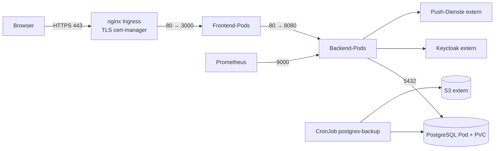

# Umgebungen und Infrastruktur Ebene 1

Pro Umgebung ein Namespace mit dem Release `chronos`; Zuordnung der Bausteine zu Ressourcen: [VT-002](VT-002-kubernetes-ressourcen.md).

**Begründung:** Kubernetes mit Helm macht beide Umgebungen aus demselben Chart reproduzierbar ([LS-009](../04-loesungsstrategie/LS-009-kubernetes-mit-helm.md), [AE-054](../09-entscheidungen/AE-054-kubernetes-mit-helm-und-github-actions.md)); nur der Ingress ist öffentlich, Backend und Datenbank bleiben im Cluster ([LS-002](../04-loesungsstrategie/LS-002-server-routen-als-proxy.md)).

**Qualitätsmerkmale:** Frontend und Backend laufen in Produktion mit mindestens 2 Replikaten ohne Sitzungszustand und mit Leader-Election für Zeitaufgaben ([LS-012](../04-loesungsstrategie/LS-012-leader-election-fuer-zeitgesteuerte-aufgaben.md)); PostgreSQL ist eine Einzelinstanz mit Volume ([R-006](../11-risiken/R-006-datenbank-ist-einziger-zustandsspeicher.md)), gesichert alle sechs Stunden ([VT-005](VT-005-backup-restore.md)); TLS am Ingress.

**Artefakte:** Backend-Image aus `backend/src/main/docker/Dockerfile.jvm` (`ghcr.io/silverminer007/chronos-backend`), Frontend-Image aus `frontend/Dockerfile` (`…/chronos-frontend`), PostgreSQL-Image `postgres:16`, Chart aus `deployment/` ([VT-004](VT-004-ci-cd-kette.md)).

| Umgebung | Namespace, Host | Values | Image-Tag | Auslöser |
|---|---|---|---|---|
| Produktion | `chronos-prod`, `chronos-live.de` | `values-prod.yaml` | `latest` | Push auf `main`; Push auf `deployment/**` in `main` |
| Staging | `chronos-staging`, `staging.chronos-live.de` | `values-staging.yaml` | `develop` | Push auf `develop` |
| Lokal | `chronos-local`, Host `localhost` | `values-local.yaml` (Provider `values`, Platzhalter-Secrets) | `latest`, `pullPolicy: IfNotPresent` | manuell per `helm install` |

Unterschiede Produktion zu Staging: Produktion Frontend 2 Replikate mit HPA 1–10, Backend 2 Replikate mit HPA 1–4 (nur CPU), Log-Level `DEBUG`, Backup-Pfad `chronos-prod-backup`; Staging Frontend und Backend je 1 Replikat ohne HPA, kleinere CPU-Limits, Probes mit 60 s Anlaufzeit. Der Deploy-Job bestimmt Namespace und Values aus dem `repository_dispatch`-Ereignis (`deploy-production`, `deploy-staging`) und überschreibt das Image des gebauten Dienstes (`overrides.yaml`).
