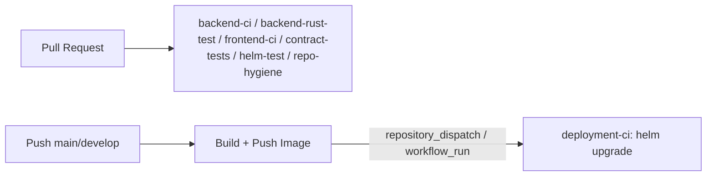

# CI/CD-Kette

| Workflow | Inhalt |
|---|---|
| `backend-ci.yml` | Tests, `verify` (Checkstyle/SpotBugs/PMD), Versionsberechnung, Image |
| `backend-rust-test.yml` | fmt, clippy, Unit-/Integrationstests mit Postgres, Image (Deploy opt-in) |
| `frontend-ci.yml` | Secret-Detection, `npm audit`, Lint, Typecheck, Build |
| `contract-tests.yml` | Harness-Unit-Tests, `parity --coverage` |
| `deployment-helm-test.yml` | Provider- und Parity-Render-Tests |
| `deployment-ci.yml` | `helm upgrade --install` |
| `repo-hygiene.yml` | keine lokalen Agent-Einstellungen im Repo |
