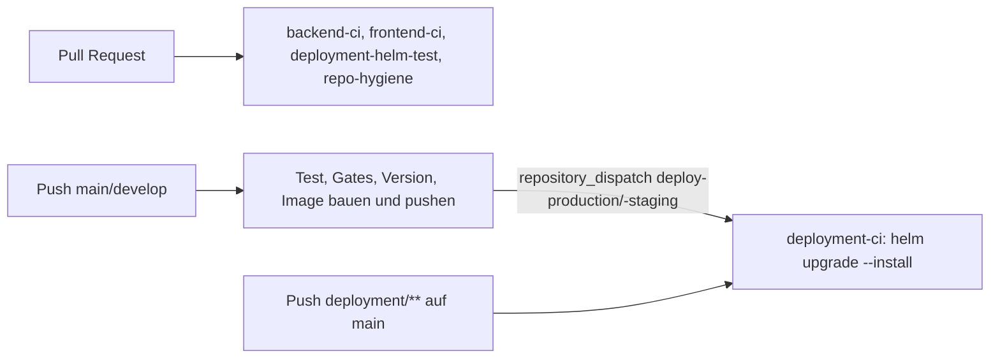

# CI/CD-Kette

| Workflow | Auslöser (Pfadfilter) | Inhalt |
|---|---|---|
| `backend-ci.yml` | PR und Push `main`/`develop`, `backend/**` | Job `test` (`./mvnw test`, JUnit-Bericht), `quality` (`./mvnw verify -DskipTests`: Checkstyle, SpotBugs, PMD), `calculate-version`, `build-jvm` (Image `ghcr.io/<owner>/chronos-backend`, Tags Version und `latest` bzw. `develop`), `deploy` (sendet `repository_dispatch`); `build-native` ist mit `if: false` abgeschaltet |
| `frontend-ci.yml` | PR und Push, `frontend/**` | gitleaks, `npm audit`, Lint, Typecheck, Build, Playwright; nur Push: Docker-Build, Push (`chronos-frontend`) und Dispatch |
| `deployment-helm-test.yml` | PR und Push, `deployment/**` | `test-providers.sh` rendert das Chart für alle Provider |
| `deployment-ci.yml` | Dispatch `deploy-staging`/`deploy-production`, Push `deployment/**` auf `main` | Kubeconfig aus Secrets, `helm template`, `helm upgrade chronos . --install` mit Values der Umgebung und Image-Override; bei Fehler Diagnoseausgabe |
| `repo-hygiene.yml` | Push und PR auf `main`/`develop` | `check-no-local-settings.test.sh` und `check-no-local-settings.sh` (keine versionierte `.claude/settings.local.json`, kein LiteLLM-Header) |

Versionierung: Auf `main` läuft `semantic-release` (nur Commit-Analyzer, setzt Git-Tags), die Image-Version ist der jüngste Tag; auf `develop` `develop-<8 Zeichen SHA>`. Eine Konfigurationsdatei für `semantic-release` gibt es nicht; es gilt das Standard-Preset des Commit-Analyzers (Conventional Commits): Nur Commits wie `feat:`, `fix:` oder mit Breaking Change erzeugen einen neuen Tag, Commits nach der PR-Konvention `Resolve #<Ticket>: …` ([RA-001](../02-randbedingungen/RA-001-branch-und-pr-workflow.md)) allein nicht. Ohne neuen Tag baut `main` das Image unter dem bisherigen jüngsten Tag.
