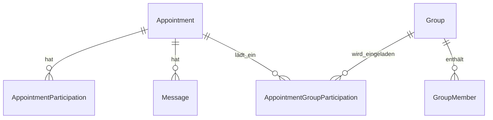

# Domänenmodell

Benutzer sind keine Entität: Verweise tragen die `oidcId` (Keycloak-Subject) als String (`user_oidcid`, `owner_oidcid`, `requester_oidcid`, `sender_oidcid`).

| Entität | Wesentliche Felder |
|---|---|
| `Appointment` | `name`, `description`, `venue`, `startTime`, `endTime`, `status`, `minimalAttendees` (optional), `createdAt`, `lastUpdate` |
| `AppointmentParticipation` | `userOidcId`, `role` (`UserRole`), `status` (`ParticipationStatus`), `groupParticipationId` (Gruppe, über die die Teilnahme entstand) |
| `AppointmentGroupParticipation` | `group`, `appointment`, `role` |
| `Group` | `groupName`, `ownerOidcId`, `members` |
| `GroupMember` | `group`, `userOidcId` |
| `FriendshipRequest` | `requesterId`, `addresseeId`, `status`, `createdAt`, `respondedAt` |
| `Message` | `body`, `senderOidcId`, `timeStamp`, `appointment` |
| `Settings` | je Ereignisart eine Einstellung ([BB-013](../05-bausteine/BB-013-push-benachrichtigungen.md)) |
| `PushSubscription` | `endpoint`, `auth`, `p256dh`, `userOidcId` |
| `PushNotificationLog` | Versandprotokoll mit Typ, Nutzlast, HTTP-Status, Fehler |
| `UserProfile` | Profil-Cache ([KZ-012](KZ-012-identitaet-und-profil-cache.md)) |

Enums: `AppointmentStatus` (`PLANNED`, `CANCELLED`, `DELETED`, `NOT_ENOUGH_ATTENDEES`), `ParticipationStatus` (`PENDING`, `APPROVED`, `REJECTED`), `UserRole`, `FriendshipStatus` (`PENDING`, `ACCEPTED`, `DECLINED`), `NotificationSetting`, `AppointmentNotificationSetting`. Nicht persistiert: `UserIdentity` (aufgelöste Identität) und `ParticipationStatistik` (Zähler). Freundschaft besteht, solange eine Anfrage `ACCEPTED` ist; Löschen eines Termins setzt nur den Status `DELETED`. Fachbegriffe: [Glossar](../12-glossar/README.md).
