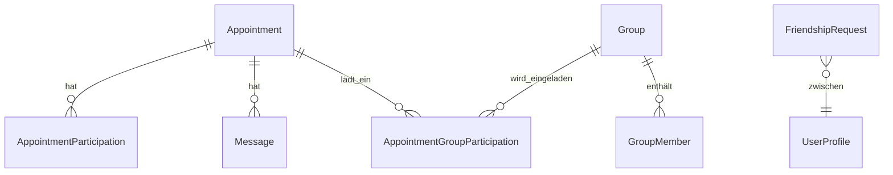

# Domänenmodell

Entitäten (Java `domain/`): `Appointment` (`name`, `description`, `venue`, `startTime`, `endTime`, `status`, `minimalAttendees`), `AppointmentParticipation` (Rolle `UserRole`, Status `ParticipationStatus`), `AppointmentGroupParticipation`, `Group`, `GroupMember`, `FriendshipRequest` (`FriendshipStatus`), `Message`, `Settings`/`NotificationSetting`/`AppointmentNotificationSetting`, `PushSubscription`, `PushNotificationLog`, `UserProfile`, `UserIdentity`, `ParticipationStatistik`. `AppointmentStatus`: `PLANNED`, `CANCELLED`, `DELETED`, `NOT_ENOUGH_ATTENDEES`. Begriffe deutsch ↔ Code: `kb/glossary/begriffe.md`.
