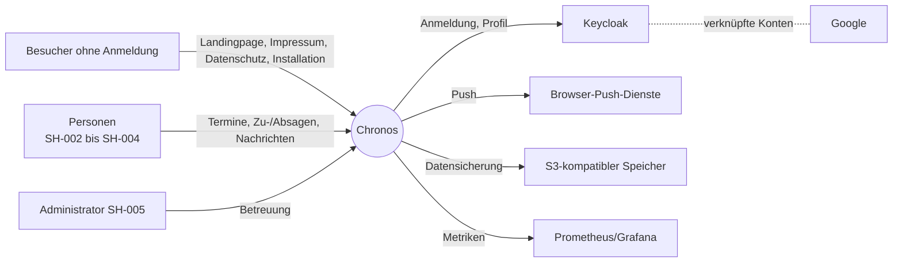

# SC-001: Systemkontext, Akteure und Nachbarsysteme

Das System Chronos umfasst die Web-App (Frontend inklusive Server-Routen) und das Backend samt Datenbank. Alles andere ist Umgebung.

| Nachbar | Art | Rolle für das Produkt | Ausgetauschte Information |
|---|---|---|---|
| Personen (Gruppenleitung, Teilnehmer, Helfer) | Mensch | Nutzen die App im Browser, installiert als PWA ([FA-016](../04-product-backlog/anforderungen/FA-016-installation-als-pwa.md)) | Termine, Zu-/Absagen, Nachrichten, Freundschaften, Gruppen, Einstellungen |
| Besucher ohne Anmeldung | Mensch | Lesen die öffentlichen Seiten ([FA-017](../04-product-backlog/anforderungen/FA-017-impressum-und-datenschutzerklaerung-bereitstellen.md), [FA-016](../04-product-backlog/anforderungen/FA-016-installation-als-pwa.md)) | Landingpage, Impressum, Datenschutzerklärung, Installationsanleitung |
| Administrator | Mensch | Betreut Daten und Push ([FA-007](../04-product-backlog/anforderungen/FA-007-admin-api.md)) | Statistik, Benutzer, Push-Protokoll, Test-Push, Umfrage-Einladung |
| Keycloak (OIDC) | System | Einzige Quelle für Identität und Anmeldung ([RB-002](../07-randbedingungen/RB-002-identitaetsprovider-ist-keycloak.md)); nicht Teil des Deployments von Chronos (Host `auth.chronos-live.de`) | Anmeldung, Registrierung, Name, E-Mail, Profilbild, verknüpfte Konten, Passkeys, Passwortänderung, Benutzersuche |
| Google | System | Externer Identitätsanbieter, den Keycloak als verknüpftes Konto anbietet ([FA-014](../04-product-backlog/anforderungen/FA-014-profil-und-konto-verwalten.md)); Microsoft und Apple sind deaktiviert | Anmeldung über das verknüpfte Konto (verläuft über Keycloak) |
| Browser-Push-Dienste (Web Push) | System | Zustellung von Benachrichtigungen an Geräte ([RB-006](../07-randbedingungen/RB-006-benachrichtigung-nur-ueber-web-push.md)) | Verschlüsselte Benachrichtigungs-Nutzlast je Geräteabo |
| S3-kompatibler Objektspeicher | System | Ablage der Datenbanksicherungen ([QA-006](../06-qualitaet/QA-006-zuverlaessigkeit-datensicherung.md)) | Datenbankdumps |
| Prometheus und Grafana | System | Betriebsüberwachung ([QA-007](../06-qualitaet/QA-007-beobachtbarkeit.md)) | Metriken, Health-Status, Alarme |

Sentry ist kein Nachbar: Das Deployment kennt Zugangsdaten (`NUXT_PUBLIC_SENTRY_DSN`, `SENTRY_AUTH_TOKEN`) und die Konfiguration einen DSN-Eintrag; weder Frontend noch Backend enthalten eine Anbindung, es werden keine Fehlerberichte übertragen.

Technische Schnittstellen, Protokolle und Ports stehen im arc42-Kapitel [03 Kontext und Abgrenzung](../../arc42/03-kontext/README.md); Begriffe im [Glossar](../../arc42/12-glossar/README.md).
