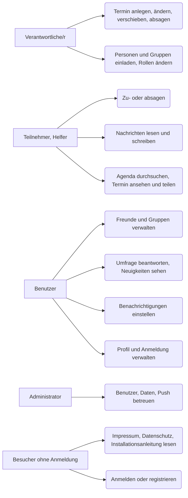

# M-001: Use-Case-Übersicht

| Use Case | Akteur | Anforderung |
|---|---|---|
| Termin anlegen, ändern, verschieben, absagen | Verantwortliche/r (Ändern ab `ATTENDANT`, siehe [M-006](M-006-rollenmatrix.md)) | [FA-001](../04-product-backlog/anforderungen/FA-001-termine-anlegen-aendern-verschieben-absagen-loeschen.md), [FA-008](../04-product-backlog/anforderungen/FA-008-terminaenderungen-nachvollziehbar-mitteilen.md) |
| Personen, Gruppen einladen; Rollen ändern | Verantwortliche/r | [FA-002](../04-product-backlog/anforderungen/FA-002-personen-und-gruppen-einladen.md), [FA-010](../04-product-backlog/anforderungen/FA-010-rolle-eines-teilnehmers-aendern.md) |
| Zu- oder absagen | Teilnehmer | [FA-003](../04-product-backlog/anforderungen/FA-003-zu-und-absage-mit-mindestteilnehmerzahl.md) |
| Nachrichten | Teilnehmer | [FA-005](../04-product-backlog/anforderungen/FA-005-nachrichten-zu-einem-termin.md) |
| Agenda, Suche, Termin ansehen, Teilen | Teilnehmer | [FA-009](../04-product-backlog/anforderungen/FA-009-terminliste-paginiert-abrufen.md), [FA-020](../04-product-backlog/anforderungen/FA-020-termin-im-detail-ansehen.md), [FA-018](../04-product-backlog/anforderungen/FA-018-termin-teilen.md) |
| Freunde und Gruppen verwalten | Benutzer | [FA-006](../04-product-backlog/anforderungen/FA-006-freundschaften-und-gruppen-verwalten.md) |
| Benachrichtigungen einstellen und empfangen | Benutzer | [FA-004](../04-product-backlog/anforderungen/FA-004-push-benachrichtigungen.md), [FA-011](../04-product-backlog/anforderungen/FA-011-automatische-erinnerungen.md), [FA-012](../04-product-backlog/anforderungen/FA-012-benachrichtigungen-konfigurieren.md) |
| Anmelden, registrieren, Einführung | Besucher, Benutzer | [FA-013](../04-product-backlog/anforderungen/FA-013-anmeldung-ueber-keycloak-und-onboarding.md) |
| Profil und Konto verwalten | Benutzer | [FA-014](../04-product-backlog/anforderungen/FA-014-profil-und-konto-verwalten.md) |
| Umfrage beantworten, Neuigkeiten sehen | Benutzer | [FA-015](../04-product-backlog/anforderungen/FA-015-nutzerumfrage-beantworten.md), [FA-019](../04-product-backlog/anforderungen/FA-019-neuigkeiten-hinweis.md) |
| Öffentliche Seiten lesen, App installieren | Besucher | [FA-017](../04-product-backlog/anforderungen/FA-017-impressum-und-datenschutzerklaerung-bereitstellen.md), [FA-016](../04-product-backlog/anforderungen/FA-016-installation-als-pwa.md) |
| Betreuen | Administrator | [FA-007](../04-product-backlog/anforderungen/FA-007-admin-api.md) |
