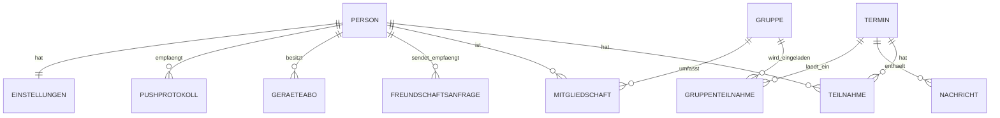

# M-002: Fachdatenmodell

| Begriff | Fachliche Eigenschaften |
|---|---|
| Person | Identität, Name, E-Mail, Bild liegen bei Keycloak; Chronos hält nur eine Kopie ([RM-010](../11-roadmaps/RM-010-nutzerdaten-nur-in-keycloak.md)) |
| Termin | Name, Beschreibung, Ort, Start, Ende, Mindestteilnehmerzahl, Status ([M-003](M-003-statusautomat-des-termins.md)) |
| Teilnahme | Person an Termin mit Rolle ([M-006](M-006-rollenmatrix.md)) und Status ([M-004](M-004-statusautomat-der-teilnahme.md)); optional Verweis auf die Gruppe, über die sie entstand |
| Gruppenteilnahme | Gruppe an Termin mit Rolle für ihre Mitglieder |
| Gruppe | Name, Besitzer; Mitgliedschaften |
| Freundschaftsanfrage | Absender, Empfänger, Status ([M-005](M-005-statusautomat-der-freundschaft.md)), Zeitpunkte |
| Nachricht | Text, Absender, Zeitpunkt; auch vom System erzeugt |
| Geräteabo | Push-Abo eines Geräts |
| Push-Protokoll | Zustellversuch mit Person, Ereignistyp, Ergebnis (Erfolg, HTTP-Status), Fehlertext und Zeitpunkt ([FA-004](../04-product-backlog/anforderungen/FA-004-push-benachrichtigungen.md)) |
| Einstellungen | Benachrichtigungsstufen je Ereignisart ([M-007](M-007-benachrichtigungsmatrix.md)) |

Begriffe: [Glossar](../../arc42/12-glossar/README.md). Technische Umsetzung: arc42, [Kapitel 8](../../arc42/08-konzepte/README.md).
