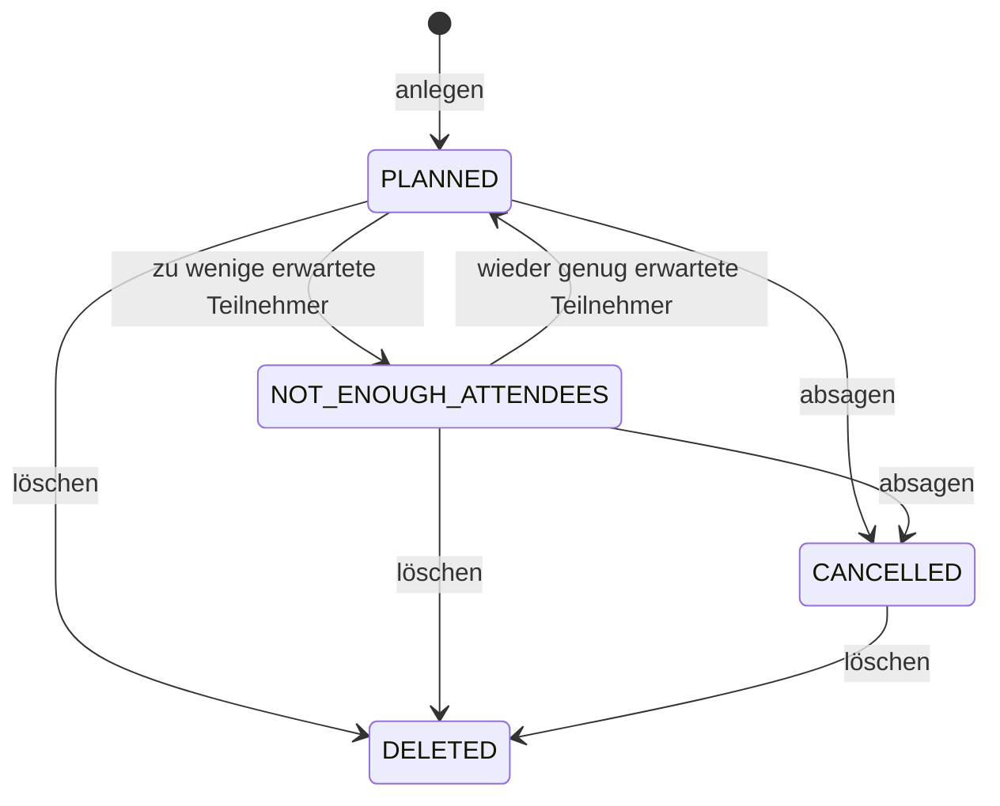

# M-003: Statusautomat des Termins

`CANCELLED` und `DELETED` sind endgültig; ein Termin lässt sich nicht wieder aufnehmen. Prüfungen entfallen für begonnene, abgesagte und gelöschte Termine sowie ohne gesetzte Mindestzahl.

| Auslöser | Regel |
|---|---|
| Zu-/Absage (nur Antwort ungleich Absage kann `NOT_ENOUGH_ATTENDEES` aufheben) | *Erwartet* = Teilnehmer − Absagen (offene zählen mit). `PLANNED` → `NOT_ENOUGH_ATTENDEES`, wenn erwartet < Mindestzahl; `NOT_ENOUGH_ATTENDEES` → `PLANNED`, wenn erwartet ≥ Mindestzahl. |
| Änderung des Termins (z. B. andere Mindestzahl) | Innerhalb der Rückmeldefrist zählen nur Zusagen, davor die erwarteten. Wird die Zahl verfehlt, → `NOT_ENOUGH_ATTENDEES`; ein Zurück nach `PLANNED` erfolgt hier nicht. |
| Zeitgesteuert (alle 15 Minuten, nur `PLANNED`) | Am Beginn der Rückmeldefrist: Zusagen < Mindestzahl → `NOT_ENOUGH_ATTENDEES`. |

Rückmeldefrist vor Start: 8 Wochen bei Dauer ab 24 Stunden; sonst 1 Woche bei Start Mo–Do, 2 Wochen bei Start Fr–So (UTC, [RA-008](../12-risiken-annahmen/RA-008-wochentagsregeln-gelten-in-utc.md)). Jeder Wechsel nach `NOT_ENOUGH_ATTENDEES` benachrichtigt alle Teilnehmer ([M-007](M-007-benachrichtigungsmatrix.md)).
