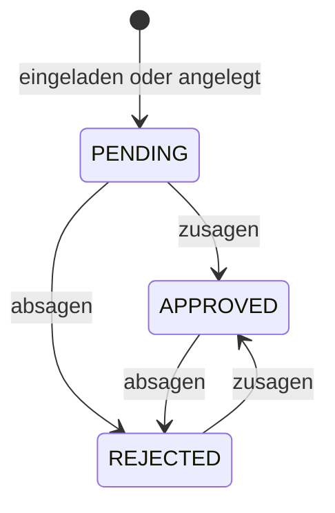

# M-004: Statusautomat der Teilnahme

Nur die betroffene Person ändert ihren Status; zurück auf `PENDING` und Wiederholung des Status sind unzulässig. Entfernen löscht die Teilnahme. Wirkung auf den Termin: [M-003](M-003-statusautomat-des-termins.md).
