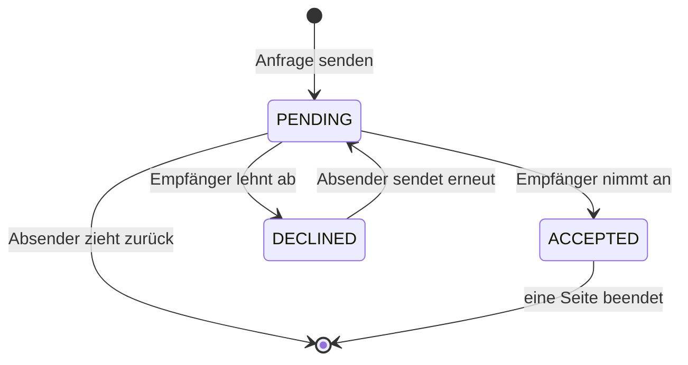

# M-005: Statusautomat der Freundschaft

`ACCEPTED` heißt befreundet; nur dann sind Einladungen zu Terminen und Gruppen möglich ([FA-002](../04-product-backlog/anforderungen/FA-002-personen-und-gruppen-einladen.md)).
